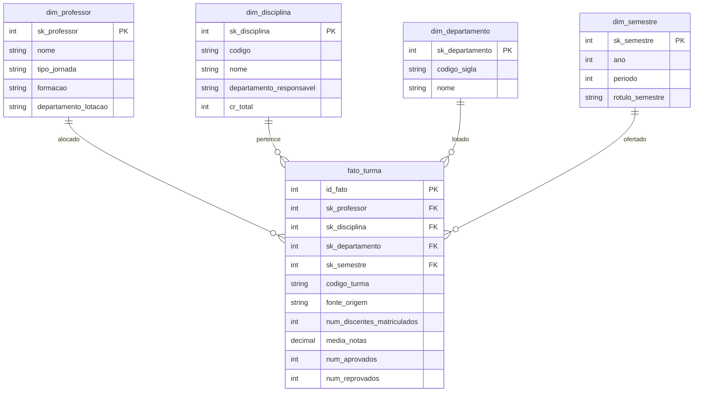

# Documento de Arquitetura de Software: Sistema Integrado de Engenharia de Dados

**Disciplina:** Engenharia de Dados  
**Professor:** André Britto de Carvalho  
**Linguagem:** Python  
**SGBDs:** PostgreSQL (AWS RDS) & MongoDB (AWS)  
**ETL:** Apache Hop  

---

## 1. Visão Geral do Sistema e Objetivos

O projeto consiste no desenvolvimento de uma aplicação em Python orientada a boas práticas de Engenharia de Software, responsável por manipular dados relacionais, não-relacionais e prover as bases para a carga de um Data Warehouse em Esquema Estrela.

O sistema divide-se em 3 grandes fases (conforme diretriz do edital):
1. **Parte 1 (CRUD Relacional):** Manipulação das tabelas `usuario`, `professor`, `turma` e `leciona` no PostgreSQL hospedado na AWS RDS.
2. **Parte 2 (Modelagem e CRUD NoSQL):** Mapeamento do modelo relacional para documentos no MongoDB hospedado na AWS, implementando CRUD para `usuario`, `estudante`, `vinculo` e `curso`, com garantia explícita de restrições relacionais (Chave, Integridade Referencial, Domínio e Not Null).
3. **Parte 3 (Integração e Data Warehouse):** Modelagem dimensional em esquema estrela no PostgreSQL e orquestração de pipelines de ETL no Apache Hop integrando o banco relacional, o banco NoSQL e os dados abertos da UFS (CSVs de 2020 a 2026).

---

## 2. Decisões Arquiteturais Explicadas

### 2.1. Arquitetura em Camadas (Layered Architecture)
Para evitar o acoplamento entre regras de negócio, interfaces de usuário e detalhes de conexão aos bancos de dados, o projeto foi estruturado em 4 camadas bem definidas:

```
┌────────────────────────────────────────────────────────┐
│           Camada de Apresentação (CLI / Menu)          │
│   Permite a interação e demonstração dos efeitos no BD │
└───────────────────────────┬────────────────────────────┘
                            │
┌───────────────────────────▼────────────────────────────┐
│              Camada de Serviços (Service Layer)        │
│   Regras de negócio, transações e validações cruzadas  │
└───────────────────────────┬────────────────────────────┘
                            │
┌───────────────────────────▼────────────────────────────┐
│      Camada de Repositórios (Repository Pattern)       │
│    Isola queries SQL (PostgreSQL) e comandos BSON/Mongo │
└───────────────────────────┬────────────────────────────┘
                            │
┌───────────────────────────▼────────────────────────────┐
│        Infraestrutura e Bancos de Dados (AWS RDS/Mongo) │
│   PostgreSQL Operacional | MongoDB | PostgreSQL DW     │
└────────────────────────────────────────────────────────┘
```

#### Por que adotamos essa separação?
- **Isolamento de Responsabilidades:** Caso a infraestrutura mude (por exemplo, migrar de psycopg para asyncpg, ou de MongoDB Atlas para DocumentDB), o restante do código permanece intacto.
- **Testabilidade e Demonstração Segura:** A camada de infraestrutura possui chaveamento automático (`is_local_fallback`), permitindo que a aplicação execute localmente (via SQLite e mock in-memory) para testes antes de rodar contra as instâncias da AWS RDS.

---

### 2.2. O Desafio NoSQL: Como Garantir Restrições Relacionais no MongoDB?
Bancos NoSQL baseados em documentos (como o MongoDB) são tipicamente projetados com consistência eventual e ausência de chaves estrangeiras nativas no motor. No entanto, o edital exige expressamente:
> *"o grupo deverá discutir como garantir as restrições definidas (restrição de chave, de integridade referencial, de domínio e not null) e implementar a representação das entidades garantindo essas restrições."*

Para atender rigorosamente a esse requisito, implementamos uma **estratégia em 3 camadas de defesa**:

```
                  ┌────────────────────────────────────────┐
                  │ 1. Camada de Domínio (Pydantic Models) │
                  │    - Valida Not Null, Tipos e Domínio  │
                  └───────────────────┬────────────────────┘
                                      │
                  ┌───────────────────▼────────────────────┐
                  │ 2. Camada de Serviço (NoSQLService)    │
                  │    - Integridade Referencial Cruzada   │
                  │    - Restrição de Remoção (On Delete)  │
                  └───────────────────┬────────────────────┘
                                      │
                  ┌───────────────────▼────────────────────┐
                  │ 3. SGBD MongoDB ($jsonSchema + Índices)│
                  │    - Unique Indexes (Restrição de Chave│
                  │    - Schema Validation nativo no BSON  │
                  └────────────────────────────────────────┘
```

1. **Restrição de Chave (PK e Unique):**
   - Garantida no MongoDB através de **Unique Indexes** (`create_index([("cpf", 1)], unique=True)`, `create_index([("matricula", 1)], unique=True)` e índice composto em vínculos).
   - Validada previamente no Repositório antes do envio.

2. **Restrição de Not Null e Domínio:**
   - **No Código:** Pydantic valida atributos obrigatórios e restrições de domínio (ex: `Literal["Ativo", "Trancado", "Formado", "Evadido"]`).
   - **No Banco:** MongoDB JSON Schema Validator (`$jsonSchema`) configurado com cláusulas `required: [...]` e validações de regex/enum em `nosql/mongo_schema_validators.py`.

3. **Restrição de Integridade Referencial (Foreign Keys):**
   - Como o MongoDB não faz joins automáticos para validar FKs, a `NoSQLService` intercepta as operações:
     - Antes de cadastrar um **Estudante**, verifica obrigatoriamente se o `usuario_id` existe na coleção `usuarios`.
     - Antes de cadastrar um **Vínculo**, verifica obrigatoriamente se o `estudante_matricula` existe e se o `curso_codigo` existe.
     - Antes de remover um **Usuário** ou **Curso**, verifica se existem registros dependentes, lançando `NoSQLIntegrityError` (comportamento análogo ao `RESTRICT` de SQL).

---

### 2.3. Modelagem do Esquema Estrela (Parte 3)
A modelagem dimensional foi desenhada no PostgreSQL seguindo a especificação do edital:



#### Granularidade da Tabela Fato:
- Cada linha da `fato_turma` representa a oferta de uma turma específica de um componente curricular em um determinado semestre, ministrada por um professor, contendo suas medidas quantitativas (matriculados, média e aprovação/reprovação).

---

### 2.4. Estratégia de ETL no Apache Hop
Para atender à integração das 3 fontes distintas (PostgreSQL operacional, MongoDB e arquivos CSV da UFS de 2020 a 2026):
- **Desacoplamento de Pipelines:** Construção de pipelines independentes para cada dimensão (`p_dim_departamento`, `p_dim_semestre`, `p_dim_disciplina`, `p_dim_professor`) e um pipeline final para a fato (`p_fato_turma`).
- **Orquestração por Workflow (`wf_carga_dw.hwf`):** Garante a execução estrita da ordem topológica (as dimensões são povoadas e indexadas antes de a tabela fato buscar as Surrogate Keys).
